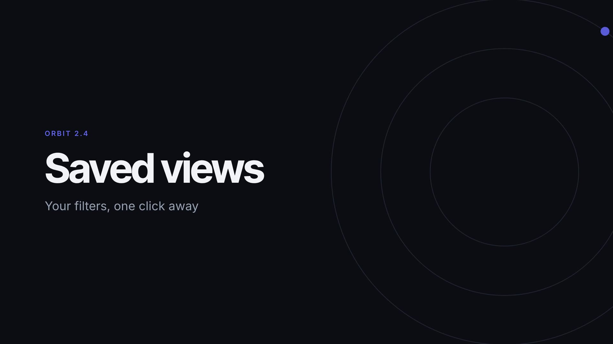

# flow-reel

**Turn a Playwright script into a narrated, polished demo video, the same way every time.**

[](https://www.npmjs.com/package/flow-reel)
[](https://docs.codeonym.work/projects/flow-reel/)
[](LICENSE)

[](https://docs.codeonym.work/projects/flow-reel/en/latest/demos/)

<p align="center"><em>▶ <a href="https://docs.codeonym.work/projects/flow-reel/en/latest/demos/">Watch the demo</a>, a reel composed from <a href="docs/demos/orbit-tour/script.ts">this short script</a>.</em></p>

You write the walkthrough of a feature as an ordinary Playwright **script**, and add a few flow-reel words:
**comments** to speak, **sounds** to play, **effects**, **cards** and **overlays** for the picture. The **composer**,
a container image, replays the script in a fresh browser, records the screen and speaks your comments. It then
polishes the picture with a smooth cursor, click ripples and zoom.

The result is a **reel**: one folder with the video, captions, a transcript, the audio and a manifest. Change one line
and compose again, and only that line is spoken again.

📖 **Documentation: [docs.codeonym.work/projects/flow-reel](https://docs.codeonym.work/projects/flow-reel/)**: a
quickstart, tutorials, a guide to every word, recipes and the full reference.

## Quickstart

You need **Node.js 22.18+** and **Docker or Podman**.

```sh
npm install --save-dev flow-reel
```

```ts
// demos/settings.ts
import { script, Sounds } from "flow-reel";

export default script({ url: "http://localhost:4173" }, async ({ page, comment, card }) => {
  comment("Dark mode is here.");
  await card.intro({ kicker: "Release 2.4", title: "Dark mode" });

  comment("Open the settings page.");
  await page.getByRole("link", { name: "Settings" }).click();
  await page.getByLabel("Dark mode")
    .comment("Turn on dark mode, and the whole app follows.")
    .sound(Sounds.controls.TOGGLE)
    .check();
});
```

```sh
export OPENAI_API_KEY=...                                  # a cloud voice: fast, and recommended
npx flow-reel compose demos/settings.ts --voice openai     # writes demos/settings.reel/
npx flow-reel verify demos/settings.reel                   # every file present and unaltered
```

`demos/settings.reel/video.mp4` is your video. The first compose pulls the composer image once (about 2.6 GB for a
cloud voice, 7 GB for the built-in local voice), and writes `flow-reel.json` with the settings it used. Commit that
file with your scripts.

→ [Quickstart](https://docs.codeonym.work/projects/flow-reel/en/latest/getting-started/quickstart/) ·
[Your first reel](https://docs.codeonym.work/projects/flow-reel/en/latest/tutorials/first-reel/)

## Voices

> [!TIP]
> **Prefer a cloud voice.** OpenAI, Gemini, OpenRouter, Together AI, Groq, ElevenLabs or any OpenAI-compatible
> server speaks a whole script in seconds, four comments at a time. The built-in local voice runs on your CPU: about
> a minute a comment, with more than 5 GiB of memory.

- **Cloud voices:** set `voice.adapter` in `flow-reel.json` (or `--voice`), and export the provider's key
  (`OPENAI_API_KEY`, `GEMINI_API_KEY`, `ELEVENLABS_API_KEY`, …). The key stays in the environment: it's passed into
  the container by name, and never written to a file, the reel or the command line.
- **The built-in local voice is Qwen3-TTS 0.6B** (`qwen3-tts-0.6b`), the only local model built in today. It's the
  default, and works offline with no key: nine speakers, ten languages.
- **Self-hosted voices:** any server that speaks OpenAI's `/audio/speech` API, such as a self-hosted Kokoro, works
  through `openai-compatible` with a `baseUrl`.
- **The reel cache:** unchanged comments reuse their clips from the previous reel, so a recompose speaks (and pays
  for) only new or changed lines.

→ [Voices](https://docs.codeonym.work/projects/flow-reel/en/latest/guide/voices/)

## Make reels with Claude

The flow-reel **plugin** teaches Claude Code and Codex to make reels for you. It plans the story, explores your
running app, writes the script, composes it, reviews the result, and hands it over with what was and wasn't checked.

```text
# Claude Code
/plugin marketplace add codeonym-oss/claude-plugins
/plugin install flow-reel@codeonym-oss

# Codex
codex plugin marketplace add codeonym-oss/claude-plugins
codex plugin add flow-reel@codeonym-oss
```

Then ask: *"Make a 30-second reel of the saved views feature. The app is on http://localhost:4173."* Its three skills
are `reel` (from a request to a finished reel), `reshoot` (change a reel from feedback) and `screening` (review a reel
without changing it).

The plugin lives in [`plugin/`](plugin/) and is released separately (`flow-reel-plugin-v*` tags). It states the
flow-reel versions it supports, and its `preflight.mjs` checks your project's.

→ [Make reels with Claude](https://docs.codeonym.work/projects/flow-reel/en/latest/tutorials/with-claude/)

## What a script can do

| | | |
|---|---|---|
| **Comments** | `comment("…")`, `locator.comment("…")` | Spoken lines with captions. The video holds the frame until each finishes. |
| **Sounds** | `sound(Sounds.feedback.SUCCESS)` | Eight UI sounds to mark moments. Clicks and typing sound by themselves. |
| **Polish** | automatic | A drawn cursor, click ripples, and zoom on clicks and typing. |
| **Effects** | `flash`, `zoomIn`, `zoomOut` | Direct the camera where the story needs it. |
| **Long waits** | `speedUp(4, fn)`, `skip(fn)` | Fast-forward a wait, or cut it with a card saying how long was cut. |
| **Cards** | `card.intro`, `chapter`, `feature`, `image`, `compare`, `outro`, `custom` | Designed screens inserted into the video, or your own HTML. |
| **Overlays** | `locator.callout`, `locator.highlight`, `lowerThird` | Point at what matters, over the running app. |
| **Brand** | `brand` in `flow-reel.json` | Your theme, accent colour, logo and fonts on every card and overlay. |

→ [Script API](https://docs.codeonym.work/projects/flow-reel/en/latest/reference/script-api/)

## Commands

```sh
npx flow-reel compose <script.ts> [--out <dir>] [--voice <name>] [--speaker <name>] [--language <name>]
                                  [--model <id>] [--api-key-env <var>] [--base-url <url>] [--no-sound] [--save-config]
npx flow-reel verify <reel>           # the reel matches its manifest (no Docker needed)
npx flow-reel compare <a.reel> <b.reel>   # same steps, comments, voice and effects, starts within ±150 ms
```

→ [CLI](https://docs.codeonym.work/projects/flow-reel/en/latest/reference/cli/)

## Requirements

- Node.js 22.18 or later. Scripts are TypeScript, run with Node's type stripping.
- Docker or Podman. Release images target Linux amd64 and arm64. Docker Desktop runs them on macOS and Windows,
  where `localhost` in a script is mapped to the host (not yet tested in CI).
- About 2.5 free CPU cores while recording. On an overloaded machine the compose stops rather than save a video
  whose timing is off.
- About 2.6 GB of disk for the composer image with a cloud voice. The built-in local voice needs the full image, about
  7 GB, and more than 5 GiB of memory.

The npm package and the composer image share one version.

## Upgrading

Breaking changes and how to move a script across them are in
[Migration](https://docs.codeonym.work/projects/flow-reel/en/latest/migration/). In short:

### From 0.4 to 0.5

`showFrame` is retired: `await showFrame("diagram.png", 3000)` becomes
`await card.image("diagram.png", { frame: "none", fit: "contain", ms: 3000 })`.

### From 0.1 to 0.2

0.2 replaced the 0.1 script words. A 0.1 script fails to load, with a pointer here.

| 0.1 | 0.2 |
|---|---|
| `import { demo } from "flow-reel"` | `import { script, Sounds } from "flow-reel"` |
| `demo(options, async ({ page, step, sfx }) => …)` | `script(options, async ({ page, comment, sound }) => …)` |
| `await step("Save.", () => button.click())` | `comment("Save."); await button.click()` or `await button.comment("Save.").click()` |
| `sfx("success")` | `sound(Sounds.feedback.SUCCESS)` |
| `npx flow-reel record demo.ts` | `npx flow-reel compose demo.ts` |
| `--no-sfx` | `--no-sound` |
| `demo.mp4`, `demo.transcript.json`, … beside the script | one folder, `demo.reel/` (delete old `.flow-reel/` folders) |
| `flow-reel compare a.transcript.json b.transcript.json` | `flow-reel compare a.reel b.reel` |

## Develop

```sh
npm ci
npm run typecheck
npm test            # unit tests
npm run test:e2e    # builds the images, tests offline synthesis, and records twice (needs Docker)
```

`flow-reel compose` always runs the composer inside the image for its package version. From a source checkout it
uses the released image of that version, not your local `src/`, and says so. To compose with local changes, build
the image under that tag first: `npm run build && docker build --target full -t
ghcr.io/codeonym-oss/flow-reel:$(node -p "require('./package.json').version") -f docker/Dockerfile .` (remove it
afterwards with `docker rmi` to go back to the released one). For a cloud voice, build `--target cloud` under that tag
with `-cloud` added.

Docs: `uv run --with-requirements docs/requirements.txt sphinx-build -W -b dirhtml docs docs/_build/html`.
[`CONTEXT.md`](CONTEXT.md) defines the project's vocabulary. Planning lives in `planning/` (see `groundwork.md`), and
releases are described in [`docs/releasing.md`](docs/releasing.md).

## License

MIT
